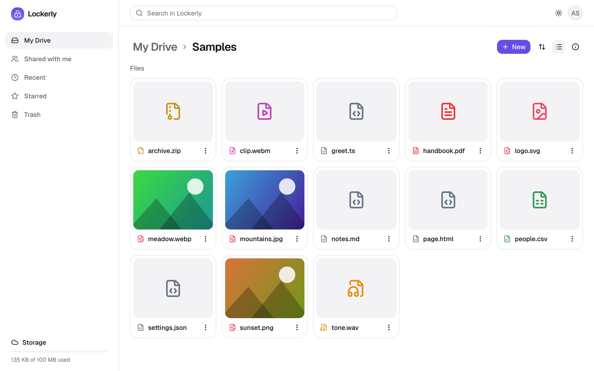
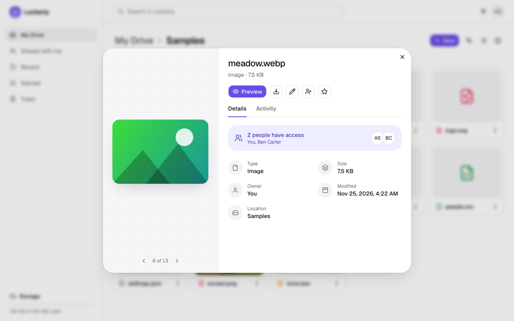
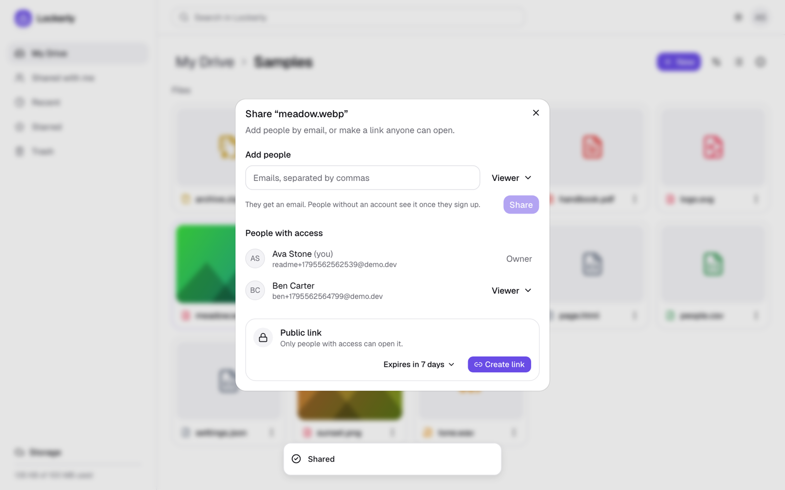
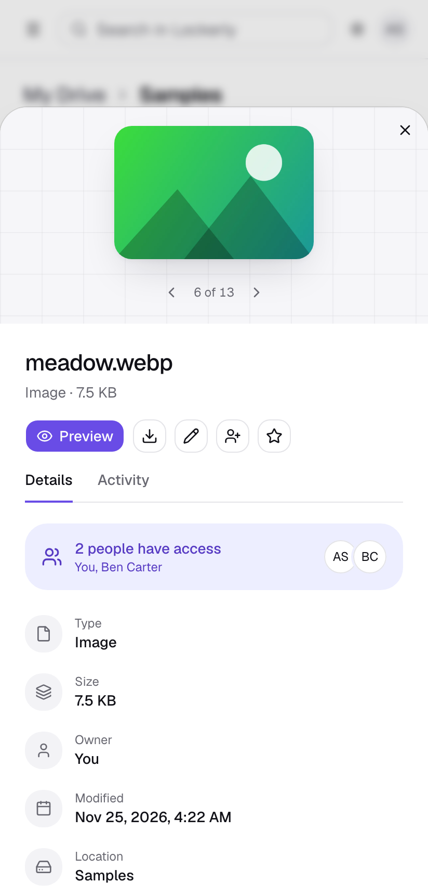
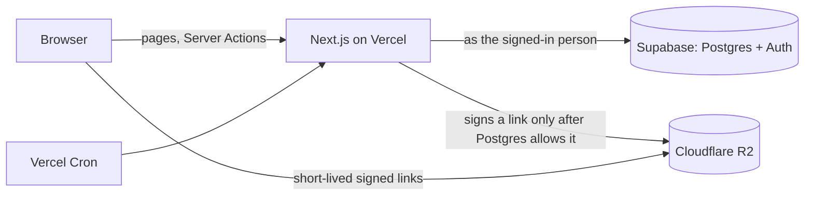

# Lockerly

**Private cloud file storage, where the database itself decides who can open each file.**

[](https://github.com/muneebulhassanpak/nextjs-supabase-r2-cloud-drive/actions/workflows/ci.yml)


### [Open the live app →](https://lockerly.heymuneeb.dev)

Create a free account to try it. It runs on free hosting tiers, so each account gets 100 MB and files can be up to 25 MB.

<picture>
  <source media="(prefers-color-scheme: dark)" srcset="docs/images/drive-dark.png">
  
</picture>

## What it does

- **Upload** by dragging files in. Progress bars, cancel and retry; uploads carry on while you move around.
- **Organise** with nested folders, drag to move, stars, recents, and a trash that keeps things for 30 days.
- **Preview** images, PDFs, video, audio, text and highlighted code without downloading.
- **Share** with people by email as a Viewer or an Editor, or with a public link that can expire and be turned off.
- **Find** anything by name, small typos included, with filters for type, owner and date.
- **See what happened**: a details window shows who has access and a timeline of every change.

It works on phones and by keyboard, in light and dark.

| Details, access and activity                                                                                                                                                                                                     | Sharing                                                                                |
| -------------------------------------------------------------------------------------------------------------------------------------------------------------------------------------------------------------------------------- | -------------------------------------------------------------------------------------- |
| <picture><source media="(prefers-color-scheme: dark)" srcset="docs/images/details-dark.png"></picture> |  |



## How it works

Next.js is the whole app, Supabase (Postgres and Auth) holds the data and the rules, and Cloudflare R2 holds the files. There is no separate backend.



- **Upload:** Postgres checks rights and quota and reserves the space, the browser sends the file straight to R2 with a signed link, then the server checks that what arrived is what was declared.
- **Download:** the server looks the file up as you. If the database returns nothing, the answer is "not found"; otherwise it signs a link, which lasts 60 seconds (30 minutes for media and PDF viewers, which keep reading).
- **Public link:** a random token, of which only a fingerprint (SHA-256) is stored. Expired, revoked and trashed are checked each time.

## Security

In plain words: **every request for a file is checked by the database, as you.** Even if the app had a bug, the database wouldn't hand over someone else's file. This is Postgres row-level security (RLS), and it's on for every table.

|                                     | Owner | Editor | Viewer | Public link | Anyone else |
| ----------------------------------- | :---: | :----: | :----: | :---------: | :---------: |
| See, preview, download              |  ✅   |   ✅   |   ✅   |     ✅      |      –      |
| Upload, rename, move, trash         |  ✅   |   ✅   |   –    |      –      |      –      |
| See who has access and the activity |  ✅   |   ✅   |   ✅   |      –      |      –      |
| Share, change roles, make links     |  ✅   |   –    |   –    |      –      |      –      |
| Delete forever                      |  ✅   |   –    |   –    |      –      |      –      |

A share on a folder covers everything inside it, and the strongest role wins.

How that's tested:

- **442 database tests** ([`supabase/tests`](supabase/tests)) act as each kind of person and check what's allowed and what's refused. A table without RLS fails the suite.
- **Mutation checks** ([script](scripts/check-policy-mutations.sh)) remove each policy, then open it to everyone, and confirm the tests notice both times.
- **Integration tests** call the API directly with a real session, as an attacker would, skipping the app.

To report a problem, see [SECURITY.md](SECURITY.md).

## Engineering highlights

- **Quotas that can't be raced:** [`start_upload`](supabase/migrations/20261113185251_api_functions.sql) reserves space under a lock, so parallel uploads can't slip past the limit ([test](tests/integration)).
- **Fast search with access rules:** [search and activity](supabase/migrations/20261118093713_search_activity.sql) filter first and check access after: 410 ms became 80 ms for search, and 8 s became 16 ms for a folder's activity, with 10,000 items per person.
- **Safe previews:** HTML and SVG are shown as source text and never run; [code highlighting](src/components/preview/code-view.tsx) builds elements, not HTML.
- **Instant changes:** [the browser](src/components/drive/folder-browser.tsx) updates at once and rolls back if the server refuses.
- **Cautious cleanup:** [the storage job](src/server/jobs/cleanup-storage.ts) refuses to run when too much looks orphaned, as a bucket paired with the wrong database would.
- **The admin key is rare:** it lives in [one server-only module](src/server/db/admin.ts), and people's requests never use it.

## Environments

|            | Branch    | Runs on                                                        |
| ---------- | --------- | -------------------------------------------------------------- |
| Local      | any       | Docker: Supabase and S3-compatible storage, no accounts needed |
| Staging    | `develop` | Its own Supabase project and R2 bucket                         |
| Production | `main`    | Its own Supabase project and R2 bucket                         |

Every change is a reviewed pull request that passes lint, types, unit, integration, database, build and browser checks. Merging applies the migrations to that environment. Releases are tagged and listed in the [changelog](CHANGELOG.md).

## Run it locally

Needs Node.js 22, pnpm 10 and Docker. No accounts or API keys.

```bash
pnpm install
pnpm db:start   # local Supabase + S3 storage in Docker (the first run downloads images)
pnpm seed:files # optional: sign in as ava@demo.dev / demo-pass-123 to try every file type
pnpm dev        # http://localhost:3000
```

## Testing

| What                                    | Count                          | Command                       |
| --------------------------------------- | ------------------------------ | ----------------------------- |
| Unit and integration (Vitest)           | 303, 92% of statements covered | `pnpm test:coverage`          |
| Database (pgTAP)                        | 442                            | `pnpm db:test`                |
| Browser (Playwright, desktop and phone) | 65                             | `pnpm build && pnpm test:e2e` |

Run the database tests on a fresh local database (`pnpm db:reset`, which clears local data).

## Design decisions

- **R2 rather than Supabase Storage:** no charge for downloads, and files never pass through the app server. R2 can't apply RLS, so it never decides access: Postgres does, before any link is signed.
- **Rules in Postgres:** quotas, unique names and moves have to hold when things happen at once, so they're constraints, triggers and functions rather than TypeScript checks.
- **Rate limits in Postgres** too: no extra service to run for a project this size.
- **Left out for now:** Google sign-in, folder uploads, and generated thumbnails (small images are shown as they are).

## Project structure

```
src/app         routes, layouts, Server Actions
src/components  the interface
src/server      services, storage, jobs, database clients (server only)
src/lib         code shared by the browser and the server
supabase        migrations, policies and database tests
tests, e2e      Vitest and Playwright
```

See [CONTRIBUTING.md](CONTRIBUTING.md) for the workflow and checks.

## About

A personal portfolio project by [Muhammad Muneeb-Ul-Hassan](https://github.com/muneebulhassanpak). Licensed under [MIT](LICENSE).
